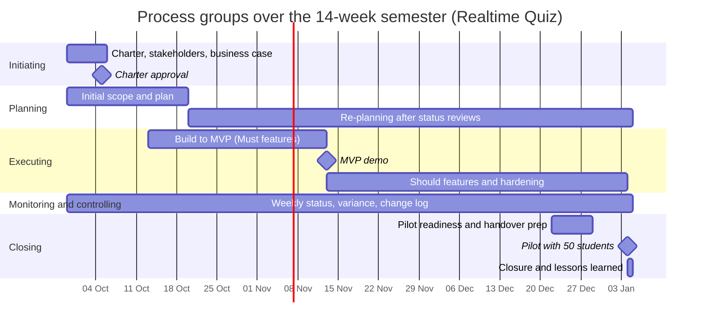

# Process groups over the semester

The process groups overlap and recur; they are not five strictly separate phases. Monitoring and controlling continues throughout the project, and planning is updated after reviews and approved changes.

| Process group | Weeks active | Main activities | Outputs | Lab that produces them |
|---|---|---|---|---|
| Initiating | 1; revisited at major gates | Confirm need, sponsor, PM, initial stakeholders, authority, and project purpose | Approved charter, initial stakeholder list, business case | Lab-01 |
| Planning | 1–3, then re-planning in weeks 4–14 | Define scope, objectives, schedule, budget, quality approach, risks, communications, and changes | Baselines and subsidiary plans; updated plans after reviews | Lab-01 charter/business case; later planning labs |
| Executing | 3–14 | Build, integrate, test, review, deploy, and prepare training/runbook | Working increments, test evidence, release candidate, handover materials | Realtime Quiz build phases; later implementation labs |
| Monitoring and controlling | 1–14 | Weekly status, schedule/cost variance, risk and issue reviews, quality checks, change requests | Status reports, risk/issue logs, change log, updated forecasts and baselines | Every lab; detailed tools in later labs |
| Closing | 14 (preparation begins before pilot) | Confirm acceptance, hand over operations, close open issues, record lessons learned, obtain sponsor sign-off | Pilot report, operations handover, lessons learned, closure approval | Lab-01 plan; final project closure |

## Phase gates

1. **Week 1 — Charter approval:** Continue only when the sponsor is named, the purpose and success criteria are agreed, the team and authority are clear, and the $200 cash cap is accepted.
2. **Week 7 — MVP demo:** Continue to the pilot phase if all Must features are demonstrated, core tests pass, major risks have owners, and the sponsor accepts the remaining plan. If not, reduce stretch scope, re-plan, or evaluate the SaaS alternative.
3. **Week 13 — Pilot readiness:** Proceed to the week-14 pilot only when the 100-simulated-student load test is reviewed, latency and timer checks have evidence, student-data approval is received, deployment/backup runbooks are ready, and blocking defects are resolved.

These gates preserve continued business justification: the sponsor reviews evidence and expected benefit before allowing the next major commitment.

## Mermaid Gantt chart

**Date note:** Week 1 starts on 2026-09-29. Each week starts seven days after the previous week. Week 7 starts 2026-11-10, so the scheduled MVP demo on 2026-11-13 falls within week 7. Week 14 starts 2026-12-29; the pilot/closure milestone is planned for 2027-01-04, the final day of the 14-week window.
