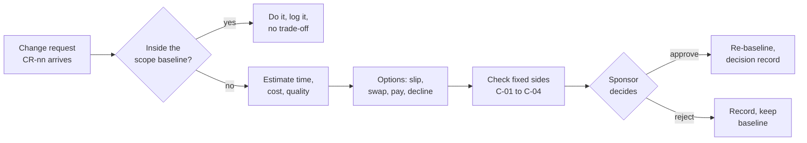

# Change requests · Realtime Quiz · trade-off analysis

Capacity 40 h/week · contingency 56 h · paid capacity 12 USD/h

Baseline: 14 weeks × 40 h = **560 h** = 504 h planned features (`features.csv`) + **56 h contingency** (10 % of 560). A week of slip therefore buys 40 h, and an hour of bought capacity costs 12 USD.

Fixed sides (from Task 1, [`constraints.md`](constraints.md)):

| Id | Constraint | Status |
|---|---|---|
| C-01 | Time: week-7 MVP and the pilot date (week 14, or week 12 after CR-03) | FIXED, driver |
| C-02 | Quality floor: O3 500 ms p95 latency, O4 100-student load test and drift below 200 ms, O5 80 % coverage + green CI | FIXED, never traded |
| C-03 | Cost: 200 USD cash cap, already fully allocated (hosting 100 + domain 15 + tools 60 + reserve 25) | FIXED |
| C-04 | Resources: four part-time students, no extra people | FIXED / LIMITED |

Scope is the side that flexes. Task 2 classes ([`moscow.md`](moscow.md)): **Must** F01–F08 (300 h) · **Should** F09 20, F10 30, F11 24, F12 12 (86 h) · **Could** F13 24, F14 40, F15 12, F16 30 (106 h) · **Won't** F17 12 h. Only Should, Could and Won't items may be swapped out.

> Pricing rule for promotions: F14 and F15 already sit in the 504 h as Could, the scope the PM drops first to protect the date (charter §9). Committing them to the pilot turns those hours from droppable buffer into fixed work, so they are priced as new committed hours.

## CR-01 · Add chat (F14, 40 h) to the Must scope · requested by sponsor

Impact: **+40 h committed = 40 / 40 = 1.0 week**. Buying it costs 40 × 12 = **480 USD**. Quality: Must work rises from 300 h to 340 h, so the Must share goes above the 60 % guideline. Chat messages also share the WebSocket broadcast channel (F05), which puts the O3 500 ms p95 target at risk.

| Option | Time impact | Cost impact | Quality impact | Fixed side? |
|--------|-------------|-------------|----------------|-------------|
| A slip the pilot to week 15 | +1 week (40/40) | 0 h bought, 0 USD | Scope and quality floor unchanged, but the Must share rises to 340/504 = 67.5 %, above the 60 % guideline in `moscow.md`. | violates C-01 |
| B swap: defer F16 question bank (30 h, Could) + F17 admin and user management (12 h, Won't) = 42 h | +0 weeks (42 h freed ≥ 40 h, 2 h spare) | 0 h bought, 0 USD | No Must touched. Instructors copy questions by hand (F16) and the PM loads the 50 accounts with a SQL script (F17). The Must share rises to 340/462 = 73.6 %, and O3 (500 ms p95) must be load-tested with chat traffic on. | ok |
| C pay: TA 40 h | +0 weeks | 40 × 12 = 480 USD (240 % of the 200 USD cap) | An outsider writing real-time code puts O5 (80 % coverage, green CI) at risk, and onboarding hours are not counted. | violates C-03, C-04 |
| D decline: F14 stays Could | +0 weeks | 0 h, 0 USD | Must share stays at 59.5 %. Chat is delivered only if the Could buffer survives to week 10. | ok |

**Recommendation: B, swap F16 + F17 (42 h) for chat.** It keeps the week-14 pilot and the cash cap, touches no Must feature, and uses only items that Task 2 rated Could and Won't.
- A is rejected because it moves the fixed week-14 pilot date (C-01).
- C is rejected because 480 USD is more than double the whole 200 USD cash cap (C-03), and the team cannot add people (C-04).
- D is rejected because a sponsor request that can be absorbed at zero time and zero cost should not be refused. The decision record still states that the Must share rises to 73.6 %.

## CR-02 · Anonymous joining (F15, 12 h) · requested by students

Impact: **+12 h committed = 12 / 40 = 0.3 week**. Buying it costs 12 × 12 = **144 USD**. Quality: a guest role lets players into sessions without the **F06 authentication and roles** Must feature. Anonymous answers also cannot be linked to students in **F10 analytics** or the **F11 export** used to evaluate the pilot.

| Option | Time impact | Cost impact | Quality impact | Fixed side? |
|--------|-------------|-------------|----------------|-------------|
| A slip the pilot | +0.3 week (12/40). The pilot is one fixed session, so it moves a whole week, to week 15. | 0 h bought, 0 USD | A guest role bypasses F06, and anonymous results cannot be attributed in F10/F11. | violates C-01 |
| B swap: defer F12 real-time notifications (12 h, Should) | +0 weeks (12 h = 12 h) | 0 h bought, 0 USD | Trades a Should for a Could. Instructors announce session events verbally (the Task 2 workaround). The F06 bypass and the F10/F11 attribution gap stay. | ok |
| C pay: TA 12 h | +0 weeks | 12 × 12 = 144 USD. Only tools 60 + reserve 25 = 85 USD is free, so cash becomes 115 + 144 = 259 USD (130 % of the cap). | Same F06 risk, and an outsider touching authentication code. | violates C-03, C-04 |
| D reduce: nickname shown on the leaderboard (F04) only, students still log in through F06 (team estimate 4 h) | +0.1 week (4/40), taken from contingency (56 → 52 h) | 0 h bought, 0 USD | F06 stays intact, but 4 h (7 %) of the contingency held for the WebSocket proxy and late-answer race risks (charter §8) goes to scope. | ok |
| E decline: F15 stays Could | +0 weeks | 0 h, 0 USD | F06 and F10/F11 attribution intact. Students join with their assigned accounts, as Task 2 planned. | ok |

**Recommendation: E, decline.** F15 stays Could and is pulled in only if Could buffer remains after week 10. Task 2 already found that assigned accounts meet the need, and anonymous joining weakens the F06 Must feature.
- A is rejected because it moves the fixed pilot date by a full week (C-01).
- B is rejected because it gives up a Should item (F12) for a Could request, which inverts the Task 2 priorities, and it still bypasses F06.
- C is rejected because 144 USD is more than the 85 USD left in the cash plan (C-03), and the team cannot add people (C-04).
- D is rejected because it spends risk contingency on a new feature that is not estimated in `features.csv`.

## CR-03 · Semester shortened by 2 weeks: pilot in week 12 · dean

Capacity lost: 2 weeks × 40 h = **80 h** (560 → 480 h). Contingency lost: 10 % of 560 = 56 h → 10 % of 480 = 48 h, so **8 h** of contingency disappears along with the two weeks.

- Work capacity: 560 − 56 = 504 h → 480 − 48 = **432 h** (80 h lost − 8 h contingency = 72 h of work capacity lost).
- Planned work of 504 h now exceeds total capacity (480 h) by **24 h** before any risk, and exceeds work capacity (432 h) by **72 h**.
- Time impact: 2 weeks. Buying back the shortfall: 72 h × 12 = **864 USD**.
- Quality impact: the O4 100-student load-test gate moves from week 13 to **week 11**, so the O3 (500 ms p95) and O5 (80 % coverage) evidence must be ready two weeks earlier.

| Option | Time impact | Cost impact | Quality impact | Fixed side? |
|--------|-------------|-------------|----------------|-------------|
| A drop the Won't item and the two largest Could items: F14 40 + F16 30 + F17 12 = 82 h | 0 weeks (pilot week 12) | −82 h of work, 0 USD. Plan 422 h, buffer 480 − 422 = **58 h** | All Must and Should intact. No chat, no shared question bank, accounts loaded by SQL script. A 58 h buffer is only 2 h above the old 56 h contingency, with less time to recover. | ok |
| B drop all Could + Won't: F13 24 + F14 40 + F15 12 + F16 30 + F17 12 = 118 h | 0 weeks (pilot week 12) | −118 h of work, 0 USD. Plan 386 h (Must 300 + Should 86), buffer 480 − 386 = **94 h** | All Must and Should intact. Also no multimedia (instructors already agreed to text-only) and no nickname joining (declined in CR-02). A 94 h buffer (19.6 % of 480) protects the O3/O4 evidence due in week 11. | ok |
| C keep scope, pay TA 72 h | 0 weeks | 72 × 12 = 864 USD (432 % of the 200 USD cap) | Full scope, but an outsider joins in the final weeks and puts O5 (80 % coverage, green CI) at risk. | violates C-03, C-04 |
| D keep scope, pilot in week 14 | +2 weeks | 0 USD | Full scope and contingency, but it ignores the dean's new date. | violates C-01 (new date set by the dean) |

Keeping full scope with no contingency is not an option: 504 h > 480 h still leaves 24 h of work undone.

**Recommendation: B, drop all Could and Won't items (118 h).** It leaves a 94 h buffer, more than the original 56 h contingency, and touches no Must or Should feature. Could items return in the order F15 (12 h), then F13 (24 h), only if the buffer is still above 48 h at the week-9 review.
- A is rejected because it keeps F13 and F15, which Task 2 and CR-02 already deprioritised, in exchange for a 58 h buffer that barely covers the 48 h contingency while the schedule is two weeks tighter.
- C is rejected because 864 USD breaks the 200 USD cash cap (C-03), and the team cannot add people (C-04).
- D is rejected because it ignores the dean's constraint and keeps the old week-14 date (C-01).

### Combined view (if all three recommendations are approved in order)

CR-01 B makes F14 a Must (340 h Must) and defers F16 + F17. CR-02 E keeps F15 as Could. CR-03 B then drops the remaining Could items, F13 24 + F15 12 = 36 h.

- Plan = 340 + 86 = **426 h**. Buffer = 480 − 426 = **54 h**, which is ≥ 48 h contingency but leaves only 6 h spare.
- Must share = 340/426 = **79.8 %**.

When CR-03 is decided, the sponsor should be asked to re-confirm CR-01, because chat is now the largest Must item that is not part of the core quiz flow.

## Process

