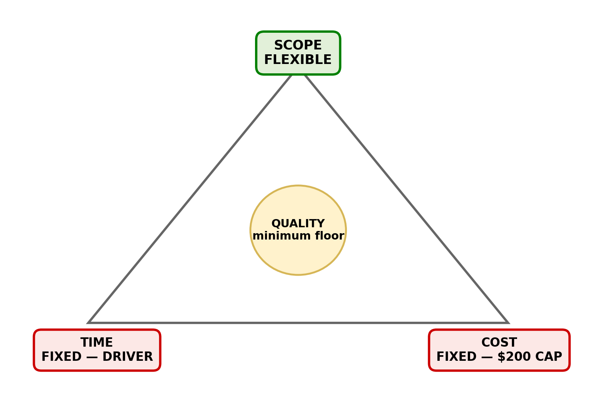

# Constraint analysis · Realtime Quiz · v0.1

| Constraint | Fixed or flexes | Evidence (quote, source) | If violated |
|------------|-----------------|--------------------------|-------------|
| Time | **FIXED (driver)** | “The project lasts 14 weeks, starting 2026-09-29.” (charter, §7 Constraints). “The MVP demo must happen in week 7; the 50-student pilot must happen in week 14.” (charter, §7 Constraints) | Missing the demo or pilot means the project fails its agreed milestones and may not meet the capstone/sponsor expectations. |
| Cost | **FIXED** | “Cash spending is capped at $200 unless the sponsor approves a change.” (charter, §7 Constraints). The budget lists a $200 total cash cap (charter, §5 Budget summary). | The team cannot pay for an overrun without written sponsor approval; purchases may need to be stopped or reduced. |
| Scope | **FLEXES** | `features.csv`: 5 Should features total 110 h and 4 Could features total 94 h. Together, 204 h of the 504 h feature estimate are lower-priority scope that can be deferred. The charter also says “The PM may defer Could features to protect the MVP.” (§9 Project manager authority). | If work takes longer than planned, Should/Could features may be deferred; if Must features are removed or major scope changes, written sponsor approval is required. |
| Quality | **FIXED (minimum floor)** | “By week 14, measured broadcast latency is at most 500 ms at the 95th percentile during the agreed pilot/load test.” (charter, §2 O3). “By week 14, achieve at least 80% line coverage, green CI on every merge, keyboard access, WCAG AA contrast checks, and support for the last two versions of major browsers.” (§2 O5) | The product may be unreliable, inaccessible, insecure, or fail the agreed success criteria; the pilot should not start with unresolved blocking defects. |
| Resources | **FIXED / LIMITED** | “The team consists of four students with limited part-time effort.” (charter, §7 Constraints). The budget estimates “Students: 4 × 14 weeks × 8 hours/week = 448 person-hours” and “Project manager: 14 weeks × 3 hours/week = 42 person-hours.” (§5 Budget summary) | The team cannot assume extra people or unlimited hours; overloading the team can cause delays, defects, or burnout. |
| Risk | **FLEXES (managed, not eliminated)** | “Campus proxy rules may block WebSocket traffic; test early and evaluate SockJS fallback.” (charter, §8 High-level risks). The charter also identifies late-answer races, client clock drift, framework compatibility, and Khmer PDF rendering as risks. | If risks are not tested or mitigated, WebSocket sessions, timing, compatibility, or exports may fail and threaten the fixed milestones or quality floor. |

## Project shape

Realtime Quiz is a **fixed-date, fixed-budget** project. The driver is **time**, because the week-7 MVP demonstration and week-14 pilot dates are fixed; **cost** is the second fixed side because cash spending cannot exceed $200 without written sponsor approval. **Scope** absorbs surprises: Must features protect the MVP, while Should and Could features can be deferred through prioritisation and change control.

The feature estimates total 504 hours, while the charter plans 490 person-hours (448 student hours + 42 project-manager hours). This is a 14-hour planning discrepancy that should be recorded and resolved; the feature estimates must not be changed silently.

## Quality floor (never traded)

1. **Performance:** broadcast latency must be at most **500 ms at the 95th percentile** during the agreed pilot/load test by week 14 (charter, §2 O3).
2. **Testing:** achieve at least **80% line coverage** and keep **CI green on every merge** by week 14 (charter, §2 O5).
3. **Capacity and timing:** pass a load test with **100 simulated students** by week 13, with server-authoritative question timing and client drift **below 200 ms** (charter, §2 O4).

Accessibility and compatibility are also part of the quality baseline: keyboard access, WCAG AA contrast checks, and support for the last two versions of major browsers (charter, §2 O5).

