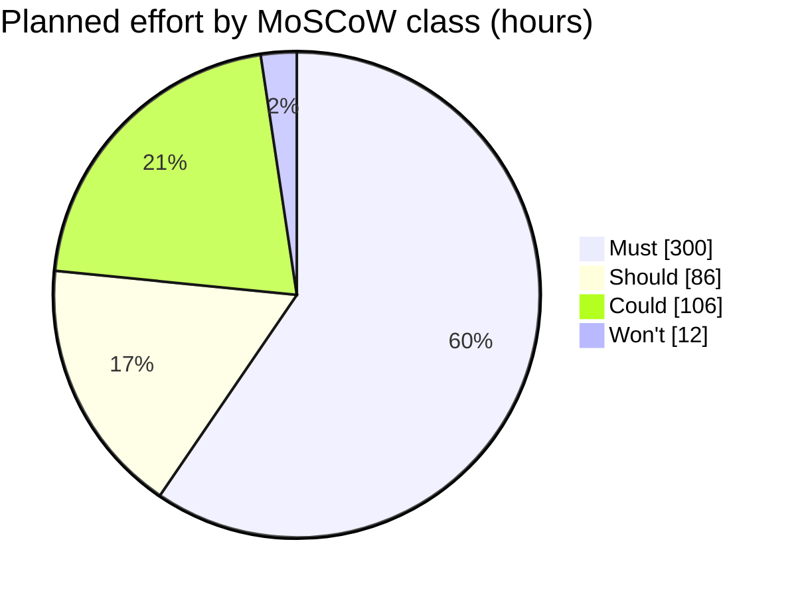

# MoSCoW rating for the week-14 pilot · Realtime Quiz

Test order: Must = pilot cancelled without it; Should = painful but a workaround exists; Could = nice to have; Won't = not in this pilot.

| Id | Feature | Plan | mine | Estimate (h) | Justification |
|---|---|---|---|---:|---|
| F01 | Create quizzes with multiple-choice questions | Must | Must | 44 | Must: without quiz creation, instructors cannot prepare the core pilot activity, so the pilot is cancelled. |
| F02 | Students participate in real time | Must | Must | 52 | Must: without real-time student participation, the main purpose of the Realtime Quiz pilot is lost and the pilot is cancelled. |
| F03 | Instant feedback and scoring | Must | Must | 28 | Must: without instant feedback and scoring, the pilot cannot demonstrate its core learning experience, so it is cancelled. |
| F04 | Leaderboards | Must | Must | 24 | Must: without leaderboards, the agreed competitive quiz experience cannot be demonstrated, so the pilot is cancelled. |
| F05 | Real-time updates over WebSocket | Must | Must | 48 | Must: without real-time updates, student answers and quiz state cannot stay synchronized, so the real-time pilot is cancelled. |
| F06 | Authentication and roles | Must | Must | 44 | Must: without authentication and role separation, access cannot be controlled safely for instructors and students, so the pilot cannot proceed. |
| F07 | Timer per question | Must | Must | 28 | Must: without question timers, the agreed timed-quiz format cannot be delivered, so the pilot is cancelled. |
| F08 | Multiple concurrent sessions | Must | Must | 32 | Must: without concurrent sessions, the planned pilot sessions cannot run as required, so the pilot is cancelled. |
| F09 | Responsive design | Should | Should | 20 | Should: a poor layout on some devices is painful, but participants can use a supported laptop or desktop browser for the pilot. |
| F10 | Analytics and reporting | Should | Should | 30 | Should: without built-in analytics, instructors must review available results manually, which is painful but workable for one pilot. |
| F11 | Export results to CSV and PDF | Should | Should | 24 | Should: instructors can open the CSV in a spreadsheet for the pilot, while PDF export is cosmetic and can wait. |
| F12 | Real-time notifications | Should | Should | 12 | Should: missing automatic notifications is painful, but instructors can announce session events verbally or through the existing session interface. |
| F13 | Multimedia in questions | Should | Could | 24 | Could: multimedia is nice to have and is the first to drop because the two instructors agreed to use text-only questions, with images deferred to release 1.1. |
| F14 | Chat during sessions | Could | Could | 40 | Could: chat is nice to have and the first to drop because participants can ask questions verbally during the pilot. |
| F15 | Anonymous joining with nickname | Could | Could | 12 | Could: nickname-based joining is nice to have and the first to drop because students can use their assigned authenticated accounts instead. |
| F16 | Question bank shared between quizzes | Could | Could | 30 | Could: a shared question bank is nice to have and the first to drop because instructors can recreate or copy questions manually for one pilot. |
| F17 | Admin role and user management | Could | Won't | 12 | Won't: admin screens are explicitly excluded from this pilot because the Project Manager can manage the 50 pilot accounts using a SQL script. |

## Totals

| Class | Features | Hours | Share of 504 h |
|---|---:|---:|---:|
| Must | 8 | 300 | 59.5% |
| Should | 4 | 86 | 17.1% |
| Could | 4 | 106 | 21.0% |
| Won't | 1 | 12 | 2.4% |
| **Total** | **17** | **504** | **100.0%** |

Must share = 300 h / 504 h × 100 = 59.5238% ≈ **59.5%** (guideline: 60% or less).

The Must class remains within the 60% guideline, with 2.4 hours of headroom below the 302.4-hour limit. No reduction of Must scope is required.

## Planned effort by MoSCoW class

